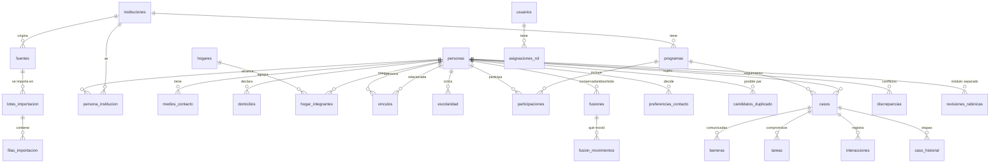

# Producto, arquitectura y modelo de datos

## 1. Resumen del producto y alcance

**Qué es.** Un CRM institucional para la Kehilá Sefaradí de Tucumán y el Colegio Maimónides: una ficha única por persona, vinculable a hogares, instituciones y programas, con historial de contactos, responsables, compromisos con fecha e indicadores con definición explícita.

**Objetivos iniciales.** (1) Acercar Maimónides a familias con hijos que no asisten a una escuela judía; (2) invitar a familias a la vida comunitaria; (3) acompañar a adultos mayores según intereses y necesidades confirmadas.

**Piloto.** Maimónides. El modelo ya admite varias instituciones y programas.

**Fuera de alcance.** Contabilidad, cuotas, donaciones, administración académica integral, historias clínicas, envíos automáticos de mensajes, IA, enriquecimiento automático de datos.

**Supuestos tomados** (cambiables sin rehacer el sistema):
- Cada archivo importado declara qué instituciones pueden usarlo; esa decisión define quién ve cada ficha.
- La búsqueda de duplicados al importar solo compara con fichas que quien importa puede ver.
- Teléfonos sin código de área se completan con 381 y se marcan con advertencia.
- La edad escolar se calcula al 30 de junio del ciclo lectivo.
- En el programa educativo, si la edad es desconocida se trata como menor: el contacto va a adultos responsables.

## 2. Arquitectura

```
Navegador (celular o PC)
   │  HTTPS
   ▼
Next.js 14 (App Router) en Vercel ── sin clave de servicio; usa la sesión del usuario
   │  JWT del usuario
   ▼
Supabase
   ├─ Auth (correo + contraseña, sin registro público)
   ├─ PostgREST (API automática sobre "public")
   └─ PostgreSQL 15+
        ├─ public    tablas operativas con RLS + funciones de negocio
        ├─ app       funciones de autorización y normalización (no expuesto)
        └─ rabinico  módulo restringido (no expuesto en la API por ahora)
```

| Pieza | Elección | Por qué |
|---|---|---|
| Frontend | Next.js 14 + React, CSS propio | Server Components reducen código en el navegador; formularios simples sin librerías de UI |
| Backend | Funciones PostgreSQL + Server Actions | La lógica crítica (importar, fusionar, revertir, validar contactos) vive junto a los datos y se prueba con SQL |
| Autenticación | Supabase Auth | Sesiones seguras sin construir un sistema propio; MFA disponible |
| Autorización | Row Level Security en PostgreSQL | Rige para cualquier cliente de la API, no solo para la interfaz |
| Base de datos | PostgreSQL gestionado | Relacional, migraciones versionadas, extensiones `unaccent` y `pg_trgm` para búsqueda |
| Almacenamiento privado | Supabase Storage con políticas (Etapa 2) | En la Etapa 1 no se suben documentos |
| Hosting | Vercel (São Paulo) + Supabase (São Paulo) | Sin servidores que mantener; una sola aplicación, sin microservicios |
| Copias | Diarias del proveedor + semanal propia cifrada | Ver README |

## 3. Modelo de datos



### Decisiones importantes

- **Identificadores UUID** en todas las tablas: permiten fusionar, revertir y migrar sin colisiones.
- **Estado de cada dato** (`desconocido`, `pendiente_verificacion`, `confirmado`, `desactualizado`) en fecha de nacimiento, contactos, domicilios, vínculos, hogares y escolaridad. Vacío no es “no”.
- **Procedencia en cada dato**: `fuente_id` y `lote_id` en contactos, domicilios y escolaridad; `fuente_alta_id`/`lote_alta_id` en la persona; `filas_importacion` guarda la fila original completa; `auditoria` registra quién cambió qué campo (sin guardar los valores).
- **Contactos compartidos**: el índice de teléfono/correo no es único entre personas. Un teléfono compartido se informa, nunca identifica.
- **Domicilio ≠ hogar**: el domicilio importado queda como dato de la persona. Los hogares se arman manualmente; no se deducen por dirección.
- **Vínculos tipados**: `parentesco`, `adulto_responsable` y `contacto_autorizado` son filas distintas aunque sean la misma persona (una madre suele tener dos).
- **Escolaridad por ciclo** sin unicidad: se conservan ciclos anteriores y discrepancias entre fuentes.
- **Casos con recorrido propio**: `catalogo_etapas` define etapas por tipo de programa; no hay un embudo único. Un caso abierto por persona y programa.
- **Tareas** con responsable y vencimiento obligatorios (restricciones `NOT NULL`), y control de que el responsable tenga acceso al programa.
- **Fusiones reversibles**: `fusion_movimientos` registra cada fila movida; revertir devuelve solo eso y deja en la ficha conservada lo cargado después.
- **Reimportación**: huella SHA‑256 del archivo (no se reimporta el mismo) y huella por fila normalizada (una fila ya importada desde la misma fuente se vincula, no se duplica).
- **Reversión de lote**: borra lo aportado por el lote que nadie verificó; conserva fichas que ya tienen datos posteriores y las informa.
- **Módulo rabínico** en esquema propio, sin referencias desde búsquedas, tableros, indicadores ni exportaciones.

## 4. Pantallas y recorridos

| Pantalla | Estado | Recorrido |
|---|---|---|
| Inicio | Hecha | Mis tareas (vencidas primero) e indicadores con filtros por institución, programa y período |
| Personas | Hecha | Búsqueda por nombre, teléfono o correo; filtros rápidos |
| Alta de persona | Hecha | Solo nombre obligatorio |
| Ficha individual | Hecha | Contactos con verificación, preferencias, vínculos, escolaridad, casos visibles, cronología, procedencia, conflictos |
| Importaciones | Hecha | Archivo → origen y alcance → vista previa → columnas → validación → revisión de coincidencias → confirmación → informe → reversión |
| Piloto Maimónides | Hecha | Tablero por ciclo con estado escolar, asignación de acercamiento y próxima acción |
| Caso de seguimiento | Hecha | Registrar contacto, cambiar etapa, barreras comunicadas, tareas, reasignar |
| Duplicados | Hecha | Pares pendientes, fusión con motivo, descarte, reversión |
| Hogares, programas, usuarios, reportes, vistas guardadas, módulo rabínico | Pendientes | Ver `estado.md` |

**Circuito del piloto:** importar padrón autorizado → revisar coincidencias → importar matrícula de Maimónides → en el tablero filtrar “Escolaridad sin verificar” → registrar escolaridad confirmada cuando la familia la informa → vincular adulto responsable → asignar acercamiento con responsable y fecha → registrar contactos y avanzar etapas → indicadores.
